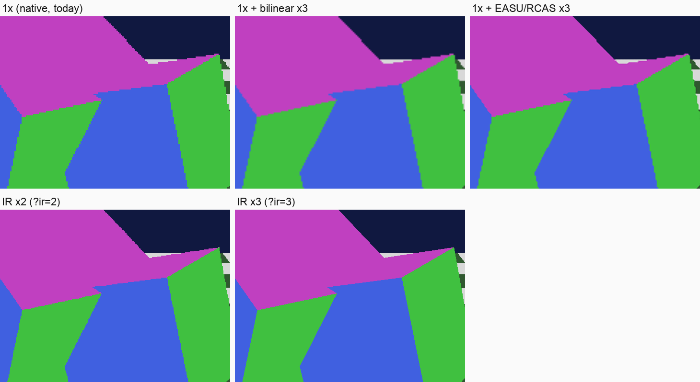

# Upscaling study: internal resolution against a presentation upscaler

Status: study and prototype (branch `study/upscaling`, patch 0082), not a
production change. Phase 2 of the programme asks for internal resolution 1×
to 4× on the WebGPU path and an output upscaler on both paths. This note
answers the question that comes before: what each one costs on this build,
and which one to ship first.

## Results in one table

Race of the local commercial disc (savestate, accelerator held), Apple M4 Pro,
Chrome 155 headless, measured 2026-10-20 02:00-02:12 under the perf lock
(MEASURE slot, 1-minute load 5.5-13.5). Base query:
`?core=upstream&video=wgpu&presenter=webgpu&cpu=dual&speed=1&wasmjit=1&jitwarmup=700&oc=1`
plus the column's flag.

| | 1× (today) | `ir=2` | `ir=3` | `upscale=easu` (1× + FSR 1 to 1280×960) |
| --- | --- | --- | --- | --- |
| Race speed, 3 runs (measured) | 75.1 / 77.8 / 73.8* % | 76.3 / 76.0 / 73.7 % | 76.6 / 74.7 / 76.8 % | 76.6 / 75.5 / 78.8 % |
| Emulated CPU thread (measured) | 99-100 % | 98-100 % | 99-100 % | 99-100 % |
| Game fps (measured) | 45-50 | 40-48 | 45-48 | 45-47 |
| Frame the game outputs | 608×448 | 1216×896 | 1824×1344 | 608×448, shown at 1280×960 |
| GPU time per present, sum of the passes, p50 (measured, upper bound) | 2.9 ms | 8.2 ms | 16.2 ms | 4.2 ms, of which the filter 1.3 ms |
| GPU utilisation, whole machine (measured, 1 s samples; 21 % before the runs) | 21 % | 25 % | 29 % | 23 % |
| Extra GPU busy time per frame, from utilisation (deduced) | — | ≈ +0.9 ms | ≈ +1.7 ms | ≈ +0.4 ms |
| Chrome GPU process footprint (measured) | 619 MB | 646 MB (+27) | 711 MB (+92) | 631 MB (+12) |
| GPU memory in use, machine (ioreg, measured) | 1786 MB | 1806 MB (+20) | 1857 MB (+71) | 1791 MB (+5) |
| Render targets, computed (EFB colour+depth, 3 XFB copies, 3 canvas images) | 9 MB | 37 MB | 83 MB | 9 MB + 10 MB (filter targets) |

\* run 3 of 1× was above the load limit (median load 13.5 > 12), shown for
completeness.

**Speed does not move.** Every configuration lands in the same 74-79 %
band, with the emulated CPU thread saturated in all of them: the spread
between runs of one configuration (4 points at 1×) is larger than any
difference between configurations. Internal resolution costs no CPU, as
expected from section 1: the CPU thread sends the same GX commands, and the
worker's replay does no per-pixel work. The GPU is the only thing that
works harder, and on this Mac it has room to spare.

**About the GPU numbers.** The timer sums every render pass's begin/end
timestamps. On Apple's tile-based GPU consecutive passes overlap, so the sum
counts the overlap: it is an upper bound (8.2 ms at 2× while the whole
machine's utilisation only rises from 21 % to 25 %). The utilisation delta,
divided by ~46 frames per second, gives the order of magnitude of the real
extra work: about 1 ms per frame at 2×, 2 ms at 3×. Both are given; neither
is a clean per-frame GPU time, which this backend cannot isolate without
also timing the copies.

Filter alone (`harness/probes/upscale-filter-bench.mjs`, 3 runs, timestamps
at full precision, throughput of 30 back-to-back filters):

| Source → output | bilinear | EASU + RCAS |
| --- | --- | --- |
| 640×480 → 1280×960 | 0.014-0.057 ms | 0.157 ms |
| 640×480 → 1920×1440 | 0.027 ms | 0.339 ms |
| 1280×960 → 1920×1440 | 0.027 ms | 0.338 ms |
| 640×480 → 2560×1440 | 0.034 ms | 0.447 ms |

The in-game 1.3 ms is the same sum-of-passes upper bound; the bench's
0.16 ms is the filter's own cost.

### Pictures

Homebrew (`harness/homebrew/out/gxscene.iso`, static scene, same frame in
every capture), crop of the cube edges, every tile shown at 3× native:



- IR 2× and 3× add real detail: edges are rendered at the higher
  resolution (the staircase shrinks 2× / 3×) and match the 1× geometry
  exactly (the captures downsampled to 640×480 differ from 1× by 1.1/255 on
  average, antialiasing only, best alignment at offset 0,0).
- EASU removes the bilinear blur and keeps edges sharp, but cannot invent
  detail: the staircase of the 1× edge is still there, smoothed.

The same comparison on the race (local only, never published; PROGRAM.md
rule 9): `~/projects/gc-web-emu/screenshots/upscale-study/captures-race/`
(`race-compare.png` and the full frames per configuration). It shows the
same: the vehicle's wheels, the track's border blocks and the characters are
much sharper at 2× and 3×. What stays native: alpha-tested foliage edges
(texel-sized steps at any IR, as in desktop Dolphin) and everything drawn
from an EFB copy (`COPY_EFB_SCALED` off).


## 1. How Dolphin does internal resolution

One setting, `GFX_EFB_SCALE` (`[Settings] InternalResolution`, default 1;
0 = "auto", an integer multiple of the window), read into
`VideoConfig::iEFBScale` (`VideoCommon/VideoConfig.cpp:128`). Everything else
follows from the size of the EFB:

| Piece | Where | At scale N |
| --- | --- | --- |
| EFB colour and depth | `FramebufferManager::CreateEFBFramebuffer` (`FramebufferManager.cpp:210-222`) | 640N × 528N, capped by the backend's max texture size |
| Viewport, scissor | `VertexShaderManager.cpp:350`, `BPFunctions.cpp:206` (`EFBToScaledX/Y`) | the GX rectangles are multiplied by N, the geometry is unchanged |
| XFB copies (the frame) | `TextureCacheBase::CopyRenderTargetToTexture` (`TextureCacheBase.cpp:2193-2221`) | always at N (`is_xfb_copy`) |
| EFB copies to textures (render to texture: shadows, reflections, blur, minimap) | same function | at N only with `GFX_HACK_COPY_EFB_SCALED` (upstream default **true**); otherwise downsampled to native with a 2×2 box filter (`linear_filter`, exact only at 2×) |
| EFB peeks/pokes, bounding box | `FramebufferManager::CreateReadbackFramebuffer` (`:700-730`), `:806` | read from a native-size cache, filled by an extra downsampling copy when N ≠ 1 |
| Presentation | `Presenter::SetBackbuffer(g_gfx->GetSurfaceInfo())` (`Present.cpp:126`) | the XFB (N×) is blitted to the backbuffer's draw rectangle |

The CPU side of the emulator does not change with N: the same GX commands,
the same vertices, the same number of draws. The extra work is GPU fill rate
(N² pixels in every EFB pass and every XFB copy) and GPU memory (N² for every
render target). Two exceptions cost CPU in Dolphin: EFB copies to RAM (an
encode pass then a GPU→CPU readback, whose source is N² larger) and EFB
peeks (one downsampling copy per invalidated tile).

## 2. What blocks it in the web build

Four things, none in the GX emulation itself:

1. **Nothing sets `GFX_EFB_SCALE`.** `core/upstream/dolphin_web_core.cpp`
   configures Dolphin explicitly (backend, CPU, hacks) and never touches it, so
   it stays at its default, 1.
2. **The backbuffer is a constant 640×480 in the C++ backend.**
   `WebGPUGfx::GetSurfaceInfo` returns `{640, 480}`. The presenter would blit a
   2× XFB into that: supersampling, averaged away at presentation. Nothing
   visible would change, the cost would be paid.
3. **The canvas is a constant 640×480 in the worker.** `WGPU_BACKBUFFER_W/H`
   in `src/upstream-discio-worker.js` size the canvas once, the first time the
   backbuffer pass runs (the one-shot "bbresize").
4. **The browser defaults that make 1× cheap stay in place.**
   `GFX_HACK_COPY_EFB_SCALED` is forced to false (render-to-texture effects
   stay native), and EFB copies to RAM do nothing on WebGPU
   (`TextureCache::CopyEFB` is a stub, so is the staging texture). So the two
   CPU-side costs of section 1 do not exist on this backend, at any N.

The WebGPU backend itself has no hidden 640×528 assumption: textures,
viewports and scissors come from VideoCommon in scaled coordinates, and the
worker's replay sizes everything from the command stream. Diagnostics in the
worker key on "≤ 1024 wide" to recognise copy targets; they are logs only.

The software renderer has no internal resolution in Dolphin (it rasterises
the native EFB on the CPU). On that path only a presentation upscaler applies.

## 3. The prototype

Behind URL flags; the defaults change nothing.

| Flag | Effect | Where |
| --- | --- | --- |
| `ir=2`, `ir=3` (1 to 4) | `GFX_EFB_SCALE = N` on the WebGPU backend, backbuffer and canvas 640N × 480N | core: `dolphin_web_core.cpp`; patch 0082: `GetSurfaceInfo`; worker: canvas size |
| `upscale=easu` / `upscale=bilinear`, `upscalex=2\|3`, `sharp=0.2` | Dolphin's backbuffer pass draws into an offscreen texture; at present, FSR 1 (EASU then RCAS) or a bilinear pass writes the canvas, `upscalex` times larger. Software path: the same filter from the uploaded XFB | `src/wgpu-upscale-study.js`, worker |
| `gputime=1` | timestamp queries around every render pass of a present, summed per present (`upscaleStudyStats` worker request) | same |

EFB copies to textures stay native at every N (`COPY_EFB_SCALED` false, as
today): only the frame gets sharper. It is the conservative choice:
render-to-texture effects keep their native look and their native cost.

## 4. The presentation upscaler

`src/wgpu-upscale-study.js`: FSR 1 EASU (12-tap edge-adaptive Lanczos,
fp32) then RCAS (5-tap sharpening, 0.2 stop), ported to WGSL from AMD's
ffx_fsr1.h (MIT). Two fragment passes, no compute, nothing optional in
WebGPU: it runs on any adapter that runs the emulator. On the hardware path
Dolphin's backbuffer pass is redirected into an offscreen texture, the filter
writes the canvas at present; on the software path it reads the uploaded XFB
texture instead of the plain blit. Cost: 0.16-0.45 ms of GPU on the M4 Pro,
zero CPU (two draws per present).

What it is for: the page shows a 640×480 frame in a window several times
larger, and the browser's bilinear stretch blurs it. EASU makes that
stretch sharp. It is the only option on the software path, and the cheap
option for a GPU too weak for 2×.

What it is not: it does not add detail. The comparison above is clear:
IR 2× is visibly better than 1× + EASU at the same output size.

## 5. Consumer machines (deduced)

The programme's reference is a 2022 i5 laptop with an Iris Xe iGPU, or a
MacBook Air M1. Their GPUs have about 2.2-2.6 TFLOPS against about 9 for the
M4 Pro's: a factor of 3.5-4. Scaled by 4:

| | M4 Pro (measured / deduced) | iGPU class (deduced, ×4) |
| --- | --- | --- |
| IR 2×, extra GPU per frame | ≈ 1 ms (utilisation) to < 5 ms (sum delta) | ≈ 4 ms to < 21 ms |
| IR 3×, extra GPU per frame | ≈ 2 ms to < 13 ms | ≈ 7 ms to < 53 ms |
| EASU to 1440p | 0.34 ms | ≈ 1.4 ms |
| Extra memory, 2× / 3× | +20-30 MB / +70-90 MB | same (shared memory on these machines) |

- At 60 fps the frame is 16.7 ms. 2× fits on an iGPU by the utilisation
  estimate and risks becoming GPU-bound by the upper bound; 3× does not fit.
  These are deductions from one Mac: to check on a real iGPU before shipping
  "Auto" (P9 has no third-party machine).
- Memory is not the issue (tens of MB). WebGPU limits are not either:
  4× needs a 2560×2112 EFB, far below the guaranteed 8192 texture size.
- On every class the emulated CPU thread is the bottleneck (33-49 %
  projected speed, consumer-perf-extrapolation.md): as long as the game runs
  slower than real time, a GPU with room left over costs nothing, and none of
  these options makes the game slower on this Mac.

## 6. Recommendation

1. **Ship internal resolution, 2× by default where the GPU allows it.** It
   is the only option that adds detail, it costs no CPU (speed unchanged
   within noise, CPU thread saturated identically), and the change is small:
   one setting in the core, the backbuffer size in patch 0082, the canvas
   size in the worker. Keep `COPY_EFB_SCALED` off at first (render-to-texture
   effects stay native and cheap); offer it later as an option once the
   gate checks EFB-copy effects at 2×.
2. **Ship the EASU/RCAS output filter as the presentation step, on both
   paths.** It replaces the browser's bilinear stretch for 0.2-0.5 ms of GPU,
   it is the only upscaling the software path can have, and it is what a
   weak iGPU gets instead of 2×. It also composes with IR: 2× rendered, EASU
   to the window size.
3. **"Auto"**: 2× on Apple Silicon and discrete GPUs; 1× + EASU on
   integrated GPUs until 2× is measured on one; 3× and 4× opt-in only.
   Fall back one step when the GPU timer (or `queue.onSubmittedWorkDone`
   latency) shows the GPU above ~70 % of the frame.
4. **Streaming keeps its own resolution**: the host's encoder takes the
   canvas; with 2× it should scale down to the stream size before encoding.

### Before production

- Gate: wgpu-single render checks at `ir=2` (exact-capture references per IR;
  today's references are 1×), plus EFB-copy-heavy homebrews.
- The worker's diagnostics recognise copy targets by "≤ 1024 wide" and read
  back at most 640×480 of the source; harmless logs, to align with the size.
- The canvas is sized once (the "bbresize" one-shot). Changing IR in a
  running session needs `RecreateEFBFramebuffer` and a canvas reconfigure:
  restart-only in this prototype.
- The GPU timer sums overlapping passes; a production "Auto" should rather
  watch frame pacing.

## Limits of this study

- One machine (M4 Pro), one scene. Consumer numbers are deductions.
- 3 runs per configuration in one MEASURE slot; one 1× run above the load
  limit. Two earlier campaigns (21:00 and 22:00) were discarded: load 40-110
  from processes outside the programme froze or degraded the runs, then the
  lock was taken by another probe.
- GPU times are upper bounds or deductions from whole-machine utilisation,
  not isolated per-frame GPU times.
- Commercial-disc captures stay outside the repository.

## Reproduce

```sh
# build (docs/repro-build.md), then:
node harness/probes/upscale-campaign.mjs --iso ../roms/<disc>.iso --state ../measures/harness/<race>.sav \
  --port 8094 --out ../screenshots/upscale-study/<dir> --runs 3 \
  --speed-configs "ir=1;ir=2;ir=3;upscale=easu" --study-configs "ir=1;ir=2;ir=3;upscale=easu"
node harness/probes/upscale-study.mjs --iso harness/homebrew/out/gxscene.iso --hold "" \
  --configs "ir=1;ir=2;ir=3;upscale=easu&upscalex=3" --runs 1 --port 8094 --out <dir>
HARNESS_CHROME_ARGS=--enable-webgpu-developer-features node harness/probes/upscale-filter-bench.mjs
```

The campaign takes the perf lock once (its children use a private lock) and
must run inside a MEASURE slot.
